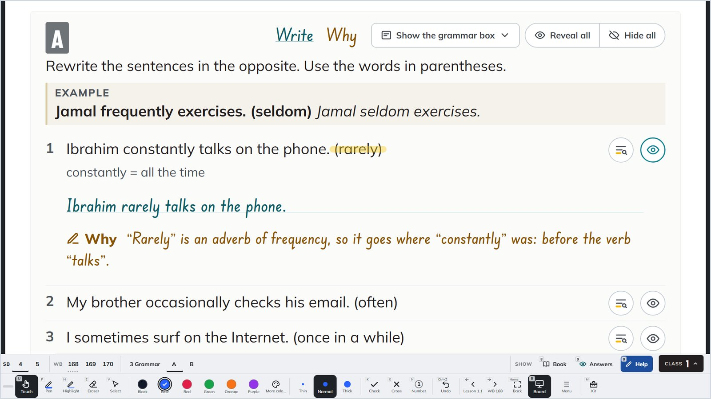
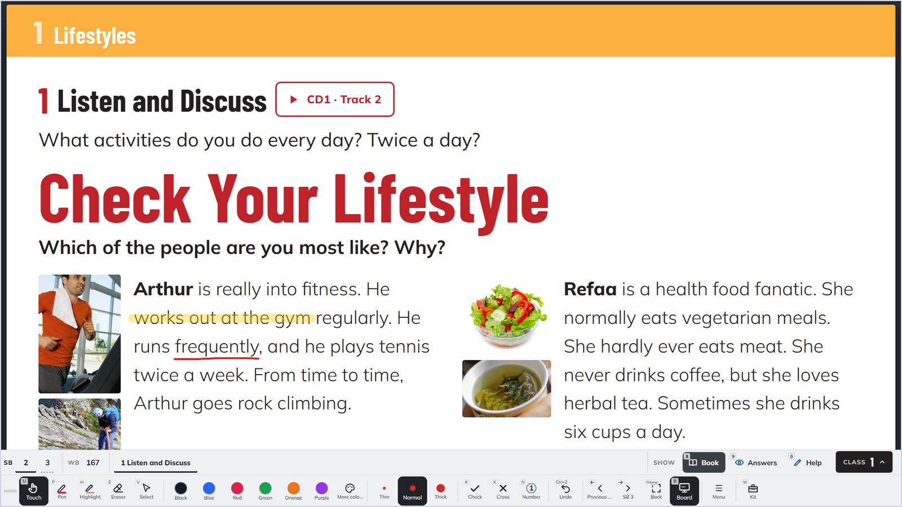
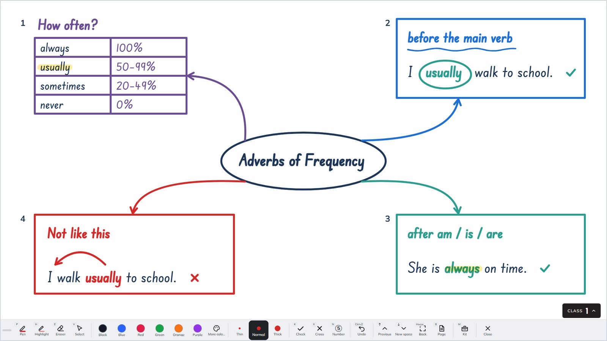
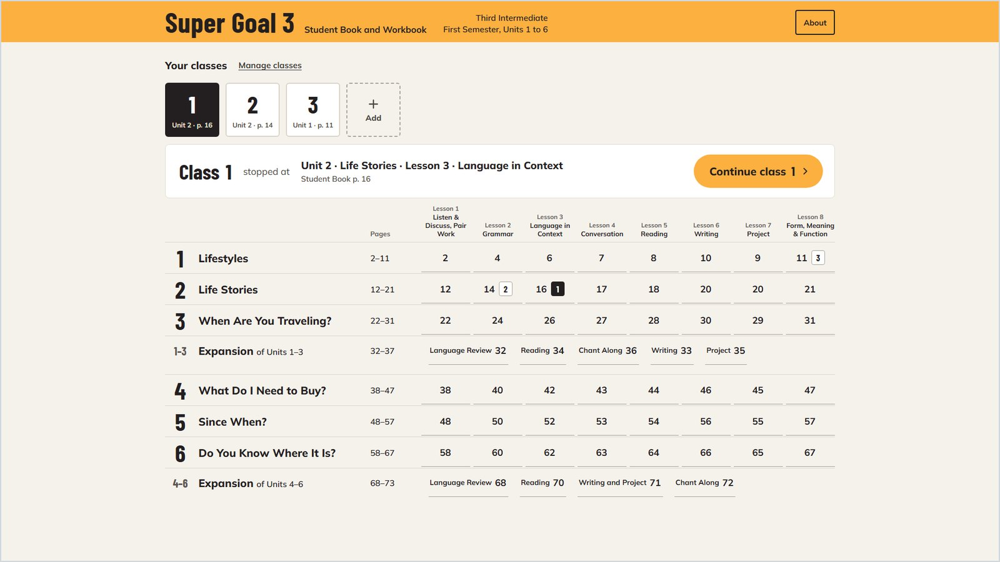
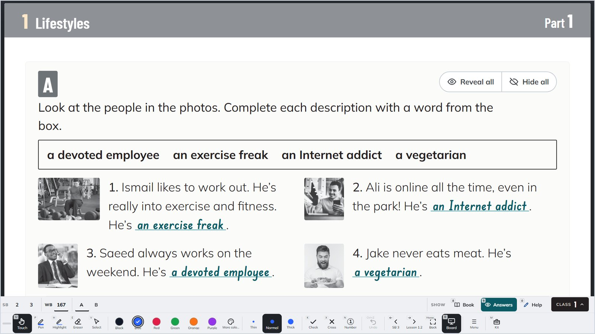
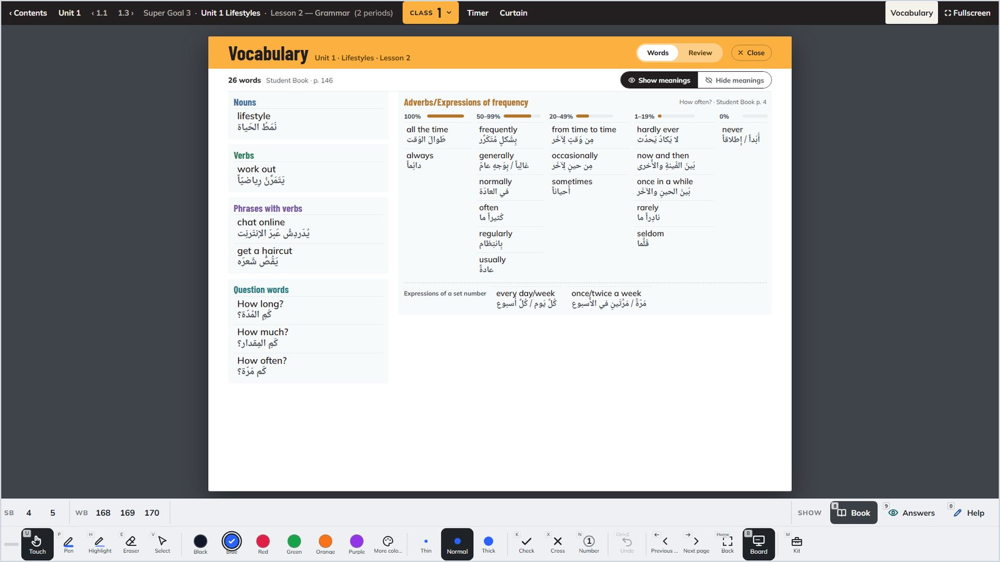
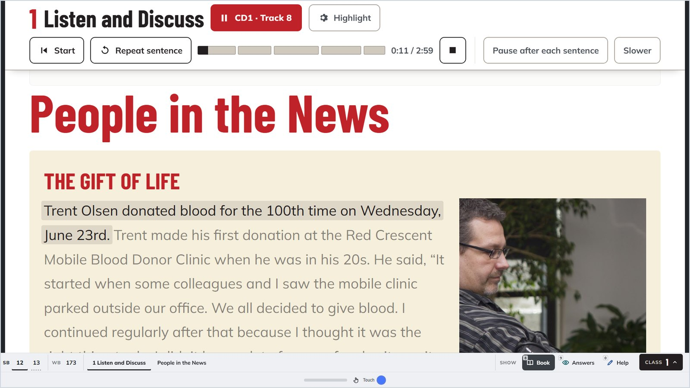

# كتاب ⁨Super Goal 3⁩ التفاعلي للسبّورة

كتاب الطالب وكتاب التمارين لمقرر ⁨Super Goal 3⁩، للصف الثالث المتوسط في الفصل الدراسي الأول، معروضاً على سبّورة الفصل. كل سؤال تحته إجابته، ولكثير منها سبب الإجابة، تفتحها حين تريد. وفي البرنامج أدوات المعلم للكتابة والشرح. برنامج لويندوز يعمل بلا إنترنت.

**[تنزيل آخر إصدار](https://github.com/Seli-14/super-goal-3-interactive-book/releases/latest)** (المثبّت نحو ⁨150⁩ ميجابايت)

ويندوز ⁨10⁩ أو ⁨11⁩ · لا يحتاج صلاحيات المدير · مجاني للمعلمين

زر العين بجانب السؤال يفتح إجابته بخط يد واضح، ومع زر ⁨Help⁩ يظهر تلميح قبلها وسبب الإجابة بعدها. و«⁨Reveal all⁩» يفتح إجابات التمرين كلها.

## ما في البرنامج

الوحدات من ⁨1⁩ إلى ⁨6⁩ في كتاب الطالب وكتاب التمارين، ومعها وحدتا المراجعة ⁨Expansion⁩، منقولة من الكتاب المطبوع كما هي بصورها وجداولها. لكل تمرين إجاباته، ولكثير منها سبب الإجابة ومكانها في الكتاب. ورمز التسجيل المطبوع في الكتاب (مثل ⁨CD1 · Track 2⁩) زر يشغّل التسجيل، ولكل درس صفحة مفرداته بمعانيها بالعربية.

## لقطات من البرنامج

اللقطات من البرنامج نفسه على شاشة ⁨1920⁩×⁨1080⁩.

### الكتابة على الصفحة

اكتب وظلّل وامسح على الصفحة نفسها، ويبقى ما تكتبه على الكلمة نفسها إذا كبّرت الخط أو تغيّرت الشاشة. وفي البرنامج مؤقّت، واختصارات لوحة المفاتيح المعتادة في البرامج الأخرى، وقلم العرض (الريموت) يفتح الإجابات ويقلّب الصفحات.

### السبّورة خلف كل صفحة

خلف كل صفحة سبّورة بيضاء تفتحها بزر ⁨Board⁩ أو مفتاح ⁨B⁩، وما تكتبه عليها يبقى مع تلك الصفحة. وفي اللقطة قاعدة الدرس على شكل خريطة ذهنية: أشكال وجدول، وأسهم منحنية تتصل بالأشكال وتتبعها إذا حرّكتها، وعلامات الصح والخطأ والأرقام، والقلم والتظليل، والكتابة بخط مدرسي واضح.

### الفهرس وفصولك

فصولك في أعلى الفهرس، ولكل فصل كتابته على الصفحات، ويفتح الكتاب كل فصل من الصفحة التي وقف عندها.

### كتاب التمارين

صفحات كتاب التمارين بلونها الرمادي الذي يميّزها عن كتاب الطالب، والإجابات في الفراغات.

### المفردات

كلمات الدرس مرتّبة كما في الكتاب. «⁨Show meanings⁩» يُظهر معانيها بالعربية، و«⁨Review⁩» مراجعة يختار فيها الطالب المعنى من أربعة.

### التسجيل

الجملة التي تُقرأ تبقى واضحة وما حولها يخفت. ومعها «⁨Repeat sentence⁩» لإعادة الجملة، و«⁨Pause after each sentence⁩» للتوقّف بعد كل جملة، و«⁨Slower⁩» للإبطاء.

## التثبيت

1. افتح صفحة [الإصدارات](https://github.com/Seli-14/super-goal-3-interactive-book/releases/latest)، ونزّل ملف المثبّت الذي يبدأ اسمه بـ ⁨Super-Goal-3-Setup⁩.
2. افتح الملف واتبع الخطوات. لا يحتاج صلاحيات المدير.
3. إن ظهرت رسالة «⁨Windows protected your PC⁩» فاضغط «⁨More info⁩» ثم «⁨Run anyway⁩». تظهر لأن البرنامج جديد ولا يحمل توقيعاً مدفوعاً.

**ما يحتاجه الجهاز:** ويندوز ⁨10⁩ (الإصدار ⁨1809⁩ أو أحدث) أو ويندوز ⁨11⁩، بنظام ⁨64⁩ بت. ويحتاج البرنامج مكوّن ⁨WebView2⁩ من مايكروسوفت، وهو موجود في ويندوز ⁨11⁩ وفي أغلب أجهزة ويندوز ⁨10⁩، فإن لم يجده المثبّت نزّله، ويحتاج الإنترنت في تلك المرة فقط. ويعمل بالقلم واللمس والفأرة.

**نسخة بلا تثبيت:** في كل إصدار ملف ينتهي اسمه بـ ⁨portable.zip⁩، تفكّه وتفتح ⁨Super Goal 3.exe⁩. وهذه النسخة لا تنزّل ⁨WebView2⁩، فلا تعمل إلا على جهاز فيه هذا المكوّن.

## عملك والتحديث

فصولك وما تكتبه محفوظة على جهازك وحده، في مجلد لا يمسّه التحديث ولا إزالة البرنامج، ولا يُرسل إلى أحد. ومن نافذة ⁨About⁩ تحفظ عملك كله في ملف بزر «حفظ عملي في ملفّ»، وتعيده على جهاز آخر بزر «استرجاع من ملفّ». ويبحث البرنامج عن إصدار جديد حين يُفتح، ويسألك قبل أن ينزّله.

## الرخصة

البرنامج مجاني للتعليم، ولك أن تعطي ملف تثبيته كما هو لزملائك المعلمين. ولا يجوز بيعه ولا تأجيره ولا تعديله ولا نشره باسم غير اسم صاحبه إلا بإذن مكتوب منه. ومحتوى كتب ⁨Super Goal 3⁩ ونصوصها وصورها، ودليل المعلم، لأصحاب حقوقها، ولا تنقل هذه الرخصة شيئاً منها. ونص الرخصة كاملاً يعرضه المثبّت قبل التثبيت.

## صاحب البرنامج

سليم القرني، معلم لغة إنجليزية. © ⁨2026⁩ جميع الحقوق محفوظة.

---

## In English

**Super Goal 3, the interactive book for the classroom board.** The Student Book and the Workbook of Super Goal 3 (Third Intermediate, first semester) on the board. Every question has its answer, and many have the reason for it, opened when you choose, and the teacher's tools for writing and explaining are on screen with it. A Windows program that works offline.

Units 1 to 6 of both books and the two Expansion units, as printed, with their pictures. The printed track marks play the recordings, and the sentence being read stays lit. You can write, highlight and erase on the page itself, and every page has a whiteboard behind it. Each class keeps its own marks and reopens where you stopped.

**Install:** download the installer whose name starts with Super-Goal-3-Setup from [Releases](https://github.com/Seli-14/super-goal-3-interactive-book/releases/latest) and open it. You need Windows 10 (version 1809 or later) or Windows 11, 64-bit, and no administrator rights. If Windows says "Windows protected your PC", choose More info, then Run anyway. If Microsoft WebView2 is missing, the installer downloads it, so it needs the internet that one time. Your classes and your writing stay on your computer, and updates and uninstalling leave them alone.

**Licence:** free for teaching, and you may give the installer, unchanged, to other teachers. You may not sell, rent or modify it, or publish it under another name, without the author's written permission. The Super Goal 3 books, their texts and pictures, and the Teacher's Guide belong to their rights holders.

© 2026 Saleem Algarni, English teacher. All rights reserved.

